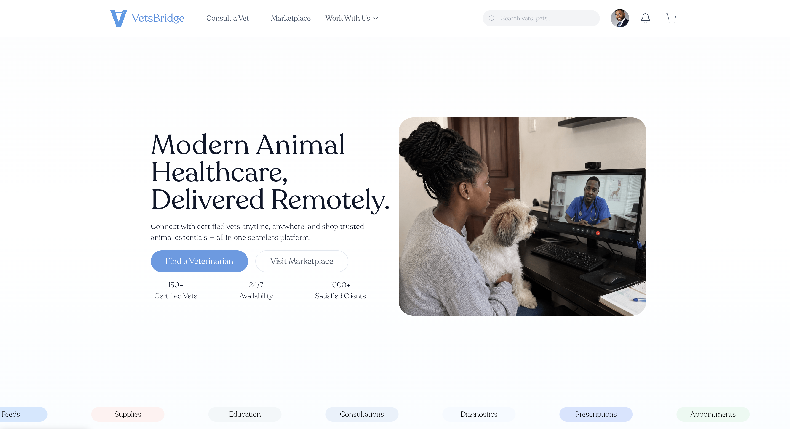
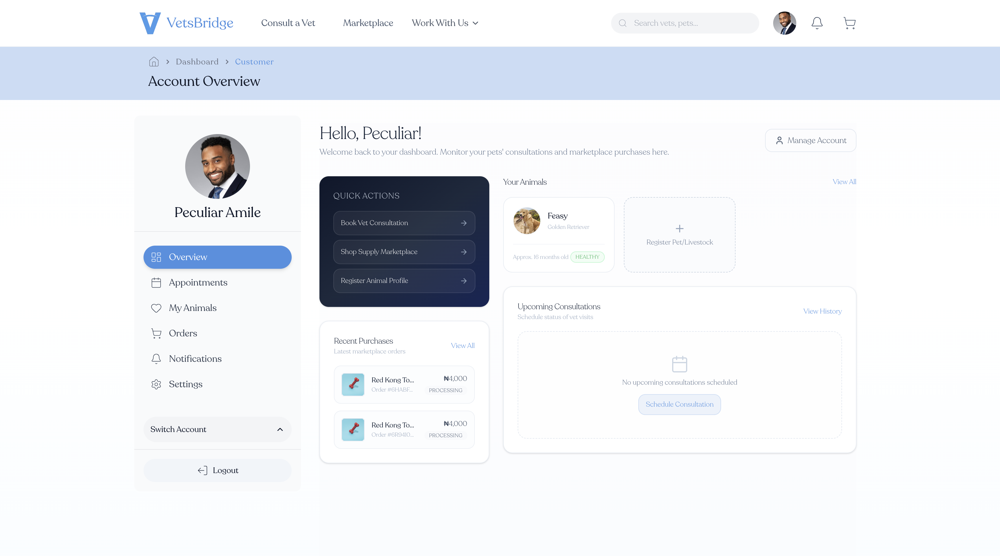

# VetsBridge

Production-grade veterinary telemedicine platform built with Next.js, NestJS, PostgreSQL, Redis, and BullMQ.

---

## 📸 Demo & Interface

<p align="center">
  
</p>

<p align="center">
  
</p>

- **Live Platform Demo**: [https://www.vetsbridge.org](https://www.vetsbridge.org)
- **API Portal & Swagger**: [https://api.vetsbridge.org/api/docs](https://api.vetsbridge.org/api/docs)

---

## ✨ Features

- **Secure Authentication**: Dual-token architecture (JWT access & refresh tokens) with Google OAuth 2.0 integration.
- **Veterinary Telemedicine**: Virtual consultation scheduling, automated lifecycle management, and instant booking.
- **Real-Time Video & Chat**: WebRTC video streaming via LiveKit and low-latency WebSocket chat via Socket.io.
- **Medical Records Management**: Patient medical history tracking, clinical notes generation, and exportable PDF summaries.
- **E-Commerce Marketplace**: Veterinary product inventory, multi-variant listings, and vendor management.
- **Order Processing & Fulfillment**: Checkout pipeline, automated inventory deduction, and delivery tracking.
- **Payment Integration**: Multi-provider payment gateway integration supporting Paystack and Flutterwave.
- **Real-Time Notifications**: In-app WebSocket alerts and email delivery via Resend/SMTP.
- **Background Job Processing**: Distributed task processing and scheduled jobs backed by BullMQ.
- **High-Performance Caching**: Cache-aside strategy powered by Redis with invalidation patterns.
- **Role-Based Access Control**: Granular RBAC supporting `ADMIN`, `VET`, `VENDOR`, and `CUSTOMER` roles.
- **Observability & Metrics**: Prometheus metrics collection (`prom-client`) with Grafana Cloud integration.

---

## 📐 Architecture Overview

```text
Next.js Frontend (App Router)
       │
       ▼  (REST API / WebSockets)
NestJS Backend (Modular Monolith)
       │
       ├──► PostgreSQL (Primary Database via Prisma ORM)
       ├──► Redis (Cache & Session Storage)
       ├──► BullMQ (Async Queues & Background Workers)
       ├──► LiveKit (WebRTC Audio/Video Streaming)
       ├──► Cloudinary (Media Assets & Image Storage)
       ├──► Paystack / Flutterwave (Payment Gateways)
       └──► Resend / SMTP (Transactional Email)
```

For full architectural details, see the [Architecture Overview Documentation](docs/architecture/overview.md).

---

## 🛠️ Tech Stack

| Layer | Technology |
| :--- | :--- |
| **Frontend** | Next.js 16, React, Tailwind CSS |
| **Backend** | NestJS (TypeScript, Modular Monolith) |
| **Database** | PostgreSQL |
| **ORM** | Prisma ORM |
| **Cache** | Redis (`ioredis`) |
| **Queue** | BullMQ |
| **Media Storage** | Cloudinary |
| **Video Telemedicine** | LiveKit WebRTC |
| **Payments** | Paystack & Flutterwave |
| **Notifications** | Socket.io (WebSockets) & Resend (Email) |
| **Monitoring & Metrics** | Prometheus & Grafana Cloud |

---

## 📁 Repository Structure

```text
vetsbridge-backend/
├── config/             # Type-safe environment & module configuration
├── docs/               # Comprehensive technical architecture & system documentation
├── infra/              # Core infrastructure modules (Prisma, Redis, Outbox, Messaging)
├── prisma/             # Database schema definition, migrations, and seed scripts
├── src/                # Application modules (Auth, Vets, Telemedicine, Marketplace, Admin)
└── test/               # Unit, integration, and E2E test suites
```

---

## 🚀 Quick Start

### Prerequisites
- Node.js (`>=18.x` or `>=20.x`)
- `pnpm` (`>=8.x`)
- PostgreSQL (`>=14`)
- Redis (`>=6.x`)

### Installation & Local Setup

```bash
# 1. Clone the repository
git clone https://github.com/vetsbridge/vetsbridge-backend.git
cd vetsbridge-backend

# 2. Install dependencies
pnpm install

# 3. Environment configuration
cp .env.example .env

# 4. Generate Prisma Client & run migrations
pnpm prisma:generate
pnpm prisma:migrate

# 5. Start development server
pnpm start:dev
```

---

## 🔐 Environment Variables

Environment variables are strictly validated on startup using **Zod** (`envSchema`). If required variables are missing or malformed, the application fails fast before initialization.

See [.env.example](.env.example) for a complete list of required environment configuration keys.

---

## 📚 Documentation

Deep-dive architectural guides, security details, and API references are available in the [`docs/`](docs/) directory:

- **Architecture**
  - [Overview & Module Layout](docs/architecture/overview.md)
  - [Authentication & JWT Flow](docs/architecture/authentication.md)
  - [Authorization & RBAC](docs/architecture/authorization.md)
  - [Database Architecture & Transactions](docs/architecture/database.md)
  - [Event-Driven Processing](docs/architecture/events.md)
  - [Notifications System](docs/architecture/notifications.md)
  - [Payments Engine](docs/architecture/payments.md)
  - [Background Queues (BullMQ)](docs/architecture/queues.md)
  - [Redis Caching Strategy](docs/architecture/caching.md)
  - [WebSockets & Real-time Messaging](docs/architecture/websocket.md)
- **Observability**
  - [Monitoring & Prometheus Metrics](docs/monitoring/monitoring.md)
- **Security**
  - [Security Architecture & Guidelines](docs/security/security.md)
- **Deployment**
  - [Production Deployment Guide](docs/deployment/deployment.md)
- **Developer Resources**
  - [Developer Setup & Guidelines](docs/developer-guide/getting-started.md)
  - [Troubleshooting & Common Issues](docs/troubleshooting/common-issues.md)

---

## 📖 API Documentation

Interactive Swagger API documentation is served across development, staging, and production environments (controlled by `SWAGGER_ENABLED=true`) at:

```text
Local:      http://localhost:3005/api/docs
Production: https://api.vetsbridge.org/api/docs
```

The Swagger specification provides full endpoint documentation, payload schemas, authorization headers, and interactive testing tools.

---

## 💡 Design Principles

- **Modular Monolith**: Code is logically organized into domain modules with strict isolation boundaries, enabling future extraction into microservices if needed.
- **Event-Driven Processing**: Asynchronous events decouple business logic and ensure immediate API responsiveness.
- **Fail-Fast Configuration**: Environment configuration is validated at runtime startup using Zod to prevent partial failures.
- **Secure-by-Default Authentication**: Multi-layered token validation, strict CORS, rate limiting, and password hashing (`argon2`/`bcrypt`).
- **Asynchronous Background Jobs**: Non-blocking processing for heavy tasks (emails, notifications, video token generation, status transitions).
- **Strict Separation of Concerns**: Controllers handle HTTP logic, Services encapsulate business domain logic, and Repositories handle database persistence.

---

## 🌟 Key Engineering Highlights

- **Transactional Outbox Pattern**: Guarantees atomic writes to the database while reliably publishing domain events without distributed transaction failures.
- **Cache-Aside Pattern**: High-throughput Redis caching for hot entities (vet profiles, product listings) with proactive invalidation hooks.
- **BullMQ Queue Workers**: Dedicated job queues for notifications, email delivery, and consultation lifecycle heartbeats.
- **Dual-Token Authentication**: Secure access token rotation alongside long-lived refresh tokens stored securely.
- **Granular Role-Based Access Control**: Decorator-driven `@Roles()` guards enforcing domain access rules across customer, vet, vendor, and admin roles.
- **Prometheus & Grafana Cloud Observability**: Custom metrics collection exposing application throughput, API latency, queue depth, and Node.js process health.
- **Environment Schema Validation**: Zod-enforced environment verification (`envSchema`) protecting deployment setups.
- **Centralized Error Handling**: Standardized exception filters formatting runtime errors into clean API responses.

---

## 🧪 Testing

The codebase includes unit tests, service tests, and end-to-end (E2E) integration suites:

```bash
# Run unit tests
pnpm test

# Run tests in watch mode
pnpm test:watch

# Run end-to-end (E2E) integration tests
pnpm test:e2e

# Generate test coverage report
pnpm test:cov
```

---

## 🚢 Deployment

VetsBridge is optimized for modern cloud platforms:

- **Backend API**: Deployed on Render / Railway / Docker
- **Frontend App**: Deployed on Vercel
- **Database**: PostgreSQL (Railway / Supabase)
- **Cache & Queues**: Redis Cloud / Railway Redis
- **Metrics**: Grafana Cloud Prometheus Remote Write

For step-by-step production deployment setup, refer to the [Deployment Documentation](docs/deployment/deployment.md).

---

## 🔮 Future Improvements

- **Multi-Region Deployment**: Low-latency edge routing for global video consultations.
- **Horizontal Auto-scaling**: Dynamic worker pod scaling with KEDA based on BullMQ queue depth.
- **Distributed Tracing**: End-to-end request tracing using OpenTelemetry.
- **Advanced Search Engine**: Vector similarity search for matching specialized veterinarians with complex animal cases.
- **Enhanced Platform Analytics**: Automated revenue distribution reports and clinical diagnostic telemetry.

---

## 📄 License

This project is licensed under the [MIT License](LICENSE).
