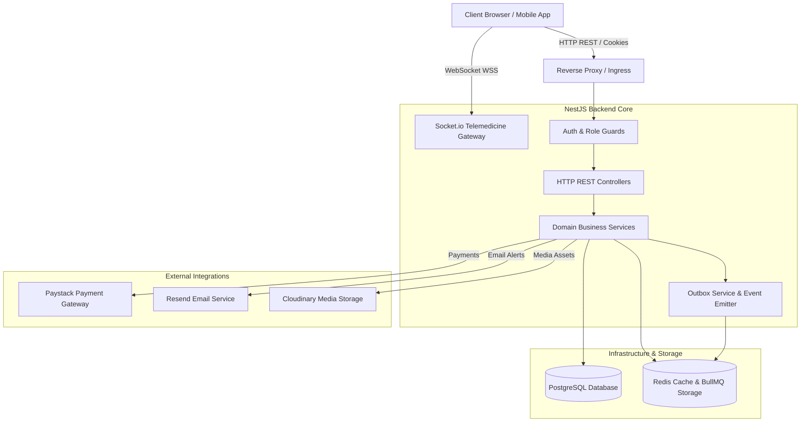

# VetsBridge Technical Documentation

Welcome to the official technical documentation for the **VetsBridge** backend and telemedicine infrastructure. This documentation is written for staff engineers, backend developers, and DevOps engineers maintaining and extending the platform.

---

## 📚 Table of Contents

### 1. Architecture Overview
* 🏗️ [Architecture Overview](architecture/overview.md) — High-level system architecture, NestJS module boundaries, and design principles.
* 🔐 [Authentication](architecture/authentication.md) — Stateful sessions, JWT access tokens, HTTP-Only cookies, and token rotation.
* 🛡️ [Authorization](architecture/authorization.md) — Role-Based Access Control (RBAC), Profile-Based Access Control (PBAC), and guards.
* ⚡ [Caching Strategy](architecture/caching.md) — Redis caching layers, key naming conventions, TTLs, and cache invalidation.
* 📥 [Background Queues](architecture/queues.md) — BullMQ job processing, retry policies, backoff strategies, and worker lifecycle.
* 🔌 [WebSocket Infrastructure](architecture/websocket.md) — Real-time Socket.io gateway, room join security, and event dispatch.
* 📤 [Transactional Outbox & Events](architecture/events.md) — Reliable domain event publishing via outbox pattern.
* 🗄️ [Database Architecture](architecture/database.md) — Prisma schema model breakdown, relationships, double-entry ledger, and indexes.
* 💳 [Payment & Ledger System](architecture/payments.md) — Paystack integration, webhook processing, ledger accounting, and payouts.
* 🔔 [Notifications Subsystem](architecture/notifications.md) — Email dispatch via Resend API, circuit breaker protection, and push notifications.

---

### 2. Security & Compliance
* 🔒 [Security Model](security/security.md) — Data encryption, secret management, rate limiting, and input validation.

---

### 3. Monitoring & Observability
* 📊 [Monitoring & Metrics](monitoring/monitoring.md) — Prometheus metrics collection, HTTP/Queue/Redis tracking, and health checks.

---

### 4. Deployment & Operations
* 🚀 [Deployment Guide](deployment/deployment.md) — Production configuration, environment variables, migrations, and process management.

---

### 5. Developer Guide
* 🏁 [Getting Started](developer-guide/getting-started.md) — Local environment setup, dependencies, and execution scripts.
* 🧩 [Adding a New Module](developer-guide/adding-module.md) — Step-by-step walkthrough for extending the API with new domain modules.
* 📏 [Coding Conventions](developer-guide/coding-conventions.md) — Architectural style, error handling patterns, and code conventions.

---

### 6. Operations & Troubleshooting
* 🛠️ [Common Issues & Troubleshooting](troubleshooting/common-issues.md) — Diagnosing Redis failures, DB locks, queue deadlocks, and migration issues.

---

## 🎯 System High-Level Architecture Diagram

---

## 🔍 Codebase Verification Standard

Every architectural statement within this documentation is derived strictly from empirical inspection of the source code in `vetsbridge-backend` and `vetsbridge-frontend`. Any capability not currently backed by code implementation is explicitly marked as:

> **Implementation not verified.**
