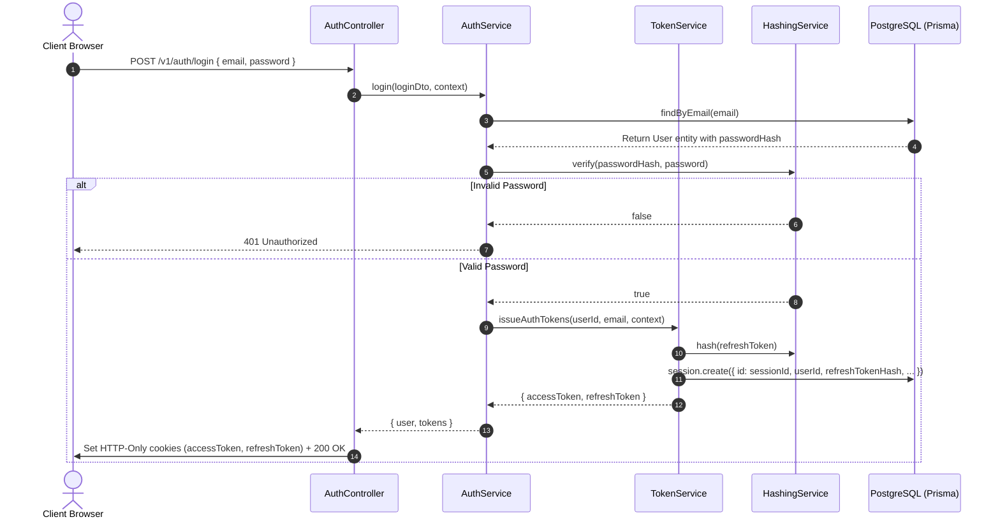
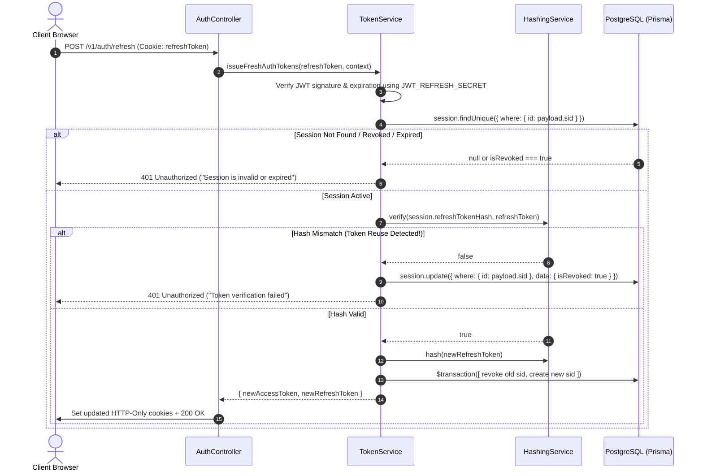
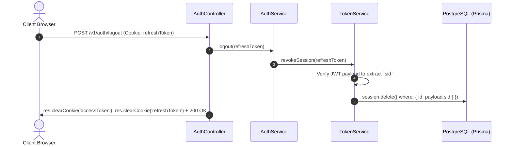

# Authentication Subsystem

## Purpose

The authentication subsystem manages user identification, registration, session tracking, multi-device security, and token lifecycle management. It enforces strict HTTP-only cookie security, password hashing, stateless short-lived access tokens, and stateful refresh token rotation with single-use reuse detection.

---

## Participating Modules & Files

* **Controller**: `src/modules/identity/auth/auth.controller.ts`
* **Services**: 
  - `src/modules/identity/auth/auth.service.ts`
  - `src/modules/identity/auth/services/token.service.ts`
  - `src/modules/identity/auth/services/hash.service.ts`
  - `src/modules/identity/auth/services/session-cleanup.processor.ts`
* **Strategies**:
  - `src/modules/identity/auth/strategies/jwt.strategy.ts`
* **Guards**:
  - `src/modules/identity/auth/guards/jwt-auth.guard.ts`
* **Prisma Models**: `User`, `Session`, `PasswordResetToken`

---

## Token Architecture & Specifications

VetsBridge implements a **dual-token HTTP-Only cookie model**:

| Property | Access Token (`accessToken`) | Refresh Token (`refreshToken`) |
| :--- | :--- | :--- |
| **Type** | Stateless JWT | Stateful DB-backed JWT |
| **Lifetime** | 15 Minutes (`15m`) | 7 Days (`7d`) |
| **Secret** | `JWT_ACCESS_SECRET` | `JWT_REFRESH_SECRET` |
| **Payload Contents** | `{ sub: userId, email }` | `{ sub: userId, email, sid: sessionId }` |
| **Cookie Flags** | `httpOnly: true`, `secure: true`, `sameSite: 'strict'/'none'` | `httpOnly: true`, `secure: true`, `sameSite: 'strict'/'none'` |
| **Storage Location** | Browser Cookie | Browser Cookie + DB `Session` table (hashed) |

---

## Request Flow Diagrams

### 1. User Login Flow

### 2. Refresh Token Rotation & Reuse Detection Flow

### 3. Logout & Global Session Revocation

---

## Design Decisions

1. **HTTP-Only Cookies Over LocalStorage**: Tokens are never exposed to client-side JavaScript execution, eliminating token theft risks from XSS vulnerabilities.
2. **Atomic Session Rotation**: Every refresh call revokes the existing session ID and issues a brand-new session ID within a single `prisma.$transaction`, eliminating race conditions.
3. **Automatic Reuse Detection**: Presenting a previously rotated refresh token triggers an security violation alert, instantly revoking the session tree.
4. **Password Reset Global Revocation**: Resetting a password invalidates all active user sessions across all devices simultaneously via `session.updateMany({ where: { userId }, data: { isRevoked: true } })`.

---

## Failure Scenarios

* **Database Offline during Refresh**: Refresh attempt fails with `500 Server Error`. Active access tokens remain valid until their 15-minute expiration timestamp.
* **Expired Refresh Token**: `jwtService.verifyAsync` throws `UnauthorizedException`, requiring the user to re-authenticate cleanly.
