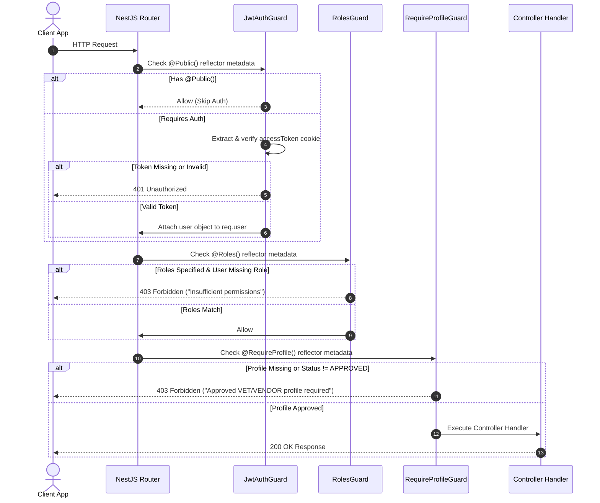

# Authorization Subsystem

## Purpose

The authorization subsystem enforces **Role-Based Access Control (RBAC)** and **Profile-Based Access Control (PBAC)** across VetsBridge API endpoints. It ensures users can only access routes and resources corresponding to their validated platform roles (`CUSTOMER`, `VET`, `VENDOR`, `ADMIN`) and active profile states.

---

## Participating Modules & Files

* **Guards**:
  - `src/modules/identity/auth/guards/jwt-auth.guard.ts`
  - `src/modules/identity/auth/guards/roles.guard.ts`
  - `src/modules/identity/auth/guards/require-profile.guard.ts`
* **Decorators**:
  - `src/modules/identity/auth/decorators/public.decorator.ts`
  - `src/modules/identity/auth/decorators/roles.decorator.ts`
  - `src/modules/identity/auth/decorators/require-profile.decorator.ts`
  - `src/modules/identity/auth/decorators/current-user.decorator.ts`

---

## Authorization Guards & Decorators

### 1. Public Decorator (`@Public()`)
Bypasses global `JwtAuthGuard` authentication for open routes (e.g. `/auth/login`, `/auth/register`, `/v1/health`, public vet listings).

### 2. Roles Decorator & Guard (`@Roles(...)` & `RolesGuard`)
Restricts endpoint execution based on the user's role array:
```ts
@Roles('ADMIN')
@Get('admin/metrics')
async getAdminMetrics() { ... }
```
`RolesGuard` inspects `req.user.roles` or `req.user.isAdmin` flag to grant access.

### 3. Profile-Based Guard (`@RequireProfile(...)` & `RequireProfileGuard`)
Verifies that a user possesses an **APPROVED** profile before granting access to specialized workflows:
```ts
@RequireProfile('VET')
@Post('consultations/notes')
async createConsultationNote() { ... }
```
If a vet's profile status is `PENDING` or `REJECTED`, `RequireProfileGuard` throws `403 Forbidden` with detailed rejection metadata.

---

## Request Authorization Lifecycle



---

## Design Decisions

1. **Global Authentication Guard**: All endpoints require JWT authentication by default via NestJS app providers, requiring explicit `@Public()` opt-outs for public routes.
2. **Multi-Role User Schema**: Users can possess multiple concurrent roles (e.g. a user can be both a `CUSTOMER` and a `VET`), allowing role switching via `RoleSwitcherDropdown` without logging out.
3. **Profile Status Verification**: Enforces profile approval states (`APPROVED`, `PENDING`, `REJECTED`) in guards rather than repeating IF-checks inside service logic.
