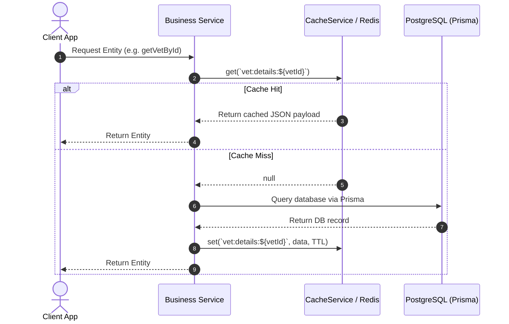

# Caching Subsystem

## Purpose

The caching subsystem provides high-performance data retrieval, reduces PostgreSQL database load, and speeds up frequently requested resources (such as marketplace product catalogs, vet directory listings, user profiles, and platform configuration).

---

## Participating Modules & Files

* **Services**:
  - `infra/redis/redis.service.ts`
  - `infra/cache/cache.service.ts`
* **Metrics Interceptor**:
  - `src/monitoring/metrics/cache.metrics.ts`

---

## Caching Strategy & Key Naming Conventions

VetsBridge uses a **Cache-Aside (Lazy Loading)** strategy with explicit key prefixes and TTLs:

| Cache Domain | Key Pattern / Example | TTL | Invalidation Trigger |
| :--- | :--- | :--- | :--- |
| **User Profile** | `user:profile:<userId>` | 1 Hour (`3600s`) | Profile updates, avatar change, password reset |
| **Vet List / Details** | `vet:details:<vetId>`, `vets:list:*` | 30 Mins (`1800s`) | Status update, slot creation, rating change |
| **Product Listings** | `product:details:<productId>`, `products:list:*` | 15 Mins (`900s`) | Product edit, inventory update, order placement |
| **Rate Limit Counters** | `rate-limit:<action>:<ip/userId>` | Variable (e.g. `60s` / `3600s`) | Automatic Redis TTL expiration |
| **Outbox Idempotency**| `outbox:processed:<eventId>` | 24 Hours (`86400s`) | Automatic Redis TTL expiration |

---

## Cache Request Lifecycle

---

## Failure Scenarios & Silent Fallbacks

* **Redis Disconnection**: If Redis goes down or times out, `RedisService` logs a warning and returns `null` for cache operations. The application falls back to querying PostgreSQL directly without crashing.
