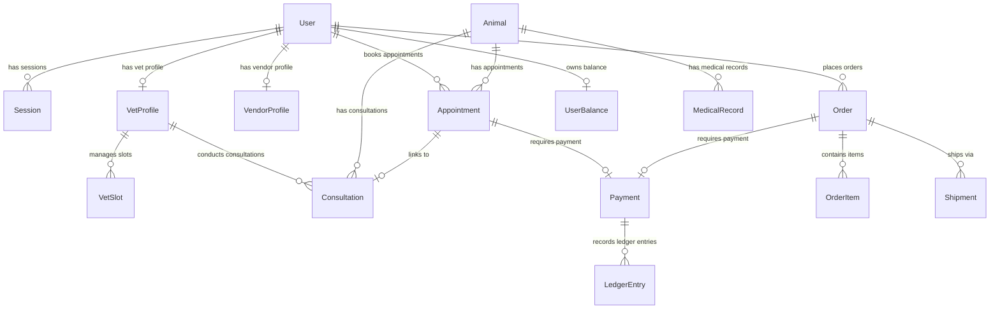

# Database Architecture & Domain Models

## Purpose

The database subsystem uses **PostgreSQL** managed via **Prisma ORM**. It provides relational persistence, double-entry financial ledger integrity, strict foreign key constraints, indexes for high-frequency queries, and optimistic concurrency locking.

---

## Core Schema Entity Aggregates

---

## Key Domain Aggregates

### 1. Identity & Profiles Aggregate
* **`User`**: Primary entity. Stores authentication metadata, account state (`isActive`, `failedLoginAttempts`, `lockoutUntil`), and profile relations.
* **`Session`**: Tracks multi-device refresh token hashes, expiration, and revocation status (`isRevoked`).
* **`VetProfile` & `VendorProfile`**: Specialized profiles with application review status (`PENDING`, `APPROVED`, `REJECTED`), ratings, and credentials.

### 2. Telemedicine Aggregate
* **`Appointment`**: Scheduled booking record between user, vet, and animal. Links to `VetSlot`.
* **`Consultation`**: Live telemedicine session tracking mode, join timestamps, medical summary notes, follow-up window (`followUpExpiresAt`), and dispute status.
* **`MedicalRecord`**: Immutable clinical records, diagnosis, treatment, and attached files.

### 3. Financial & E-Commerce Aggregate
* **`Order` & `OrderItem`**: E-commerce cart checkout purchases for physical vendor products.
* **`VendorProduct`**: Product listings with optimistic concurrency locking via `@default(0) version Int`.
* **`Payment`**: Payment transaction record storing gateway provider (`PAYSTACK`, `FLUTTERWAVE`), status, and reference.
* **`LedgerEntry`**: Immutable double-entry financial accounting ledger.
* **`UserBalance`**: Real-time balance tracking `availableBalance` and `reservedBalance`.

---

## Concurrency & Indexing Design

* **Optimistic Concurrency Control**: `VendorProduct` includes a `version Int @default(0)` field for race-free inventory decrementing.
* **Database Row Locking**: Raw `SELECT ... FOR UPDATE` SQL queries are used during financial transactions (`PayoutWorker`) and outbox polling (`OutboxPoller`) to guarantee isolation.
* **Performance Indexes**: High-cardinality foreign keys and search columns feature explicit single and compound indexes:
  - `@@index([userId])` on `Session`, `Order`, `Appointment`
  - `@@index([status, isAvailable])` on `VetProfile`
  - `@@index([published, createdAt])` on `OutboxEvent`
