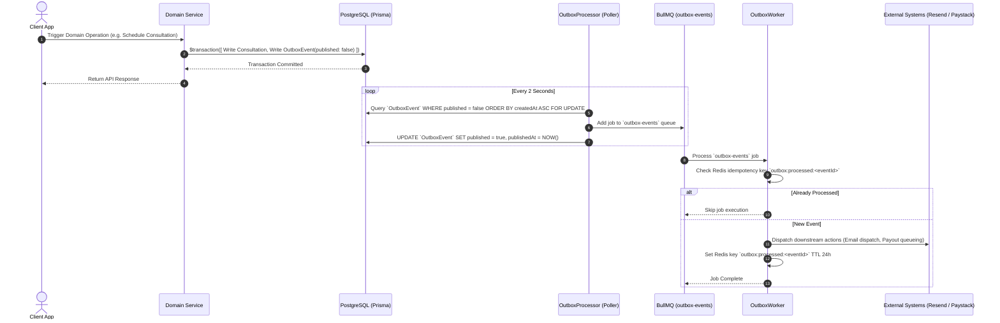

# Transactional Outbox & Events Subsystem

## Purpose

The events subsystem implements the **Transactional Outbox Pattern** to guarantee reliable event distribution across microservice boundaries and external third-party APIs (Resend, Paystack) without risking data loss or state inconsistency.

---

## Participating Modules & Files

* **Module**: `infra/outbox/outbox.module.ts`
* **Services**: 
  - `infra/outbox/outbox.service.ts`
  - `infra/outbox/outbox.processor.ts`
  - `infra/outbox/outbox.worker.ts`
* **Events**: `src/modules/payments/events/payment-event.emitter.ts`
* **Prisma Model**: `OutboxEvent`

---

## Transactional Outbox Lifecycle

---

## Implemented Event Types

| Event Type | Payload | Triggering Action | Downstream Operations |
| :--- | :--- | :--- | :--- |
| `USER_REGISTERED` | `{ userId, email, role }` | User registration | Queues welcome email notification |
| `CONSULTATION_SCHEDULED` | `{ consultationId, vetId, customerId }` | Consultation booking | Queues confirmation emails & reminder jobs |
| `PAYMENT_COMPLETED` | `{ paymentId, reference, orderId }` | Payment verification | Fulfills order, updates balances, queues payouts |
| `ORDER_PLACED` | `{ orderId, userId, amount }` | Order checkout | Logs order creation awaiting payment |

---

## Design Decisions & Reliability Guarantees

1. **At-Least-Once Delivery**: Events are guaranteed to be published because they are saved in the same DB transaction as business logic.
2. **Idempotency Guard**: `OutboxWorker` checks Redis key `outbox:processed:<eventId>` before executing tasks, preventing duplicate emails or payouts if a job is retried by BullMQ.
3. **Database Row Lock**: `OutboxProcessor` uses `SELECT ... FOR UPDATE` when polling pending outbox events to prevent concurrent worker instances from double-publishing events.
