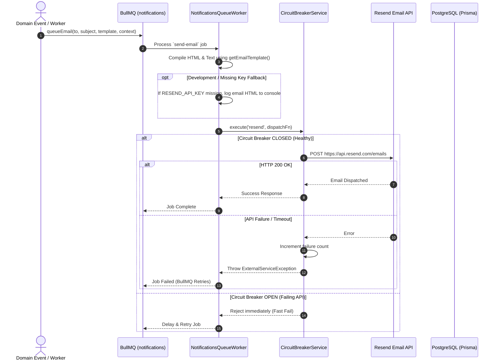

# Notifications Subsystem

## Purpose

The notifications subsystem manages multi-channel alert delivery (Email, Push Notifications, In-App Notifications) for system events such as consultation reminders, order receipts, welcome onboarding, and profile approvals.

---

## Participating Modules & Files

* **Module**: `src/modules/notifications/notifications.module.ts`
* **Services**:
  - `src/modules/notifications/notifications.service.ts`
  - `infra/queues/notifications-queue/notifications-queue.service.ts`
  - `infra/circuit-breaker/circuit-breaker.service.ts`
* **Workers**: `infra/queues/notifications-queue/notifications-queue.worker.ts`
* **Template Utility**: `src/common/utils/email-templates.ts`
* **Prisma Model**: `Notification`

---

## Email Dispatch & Circuit Breaker Flow

---

## Supported Notification Templates

* `WELCOME`: Onboarding welcome message for new users.
* `CONSULTATION_SCHEDULED_CUSTOMER` & `CONSULTATION_SCHEDULED_VET`: Booking confirmation alerts.
* `CONSULTATION_REMINDER_CUSTOMER` & `CONSULTATION_REMINDER_VET`: Pre-call reminder alerts.
* `ORDER_CONFIRMED_BUYER` & `ORDER_RECEIVED_VENDOR`: E-commerce purchase receipts.
* `PROFILE_APPROVED` & `PROFILE_REJECTED`: Application status changes.

---

## Failure Scenarios

* **Resend API Down**: The custom circuit breaker opens after 5 consecutive failures, preventing HTTP socket exhaustion. Jobs remain safe in BullMQ and automatically retry once the API recovers.
