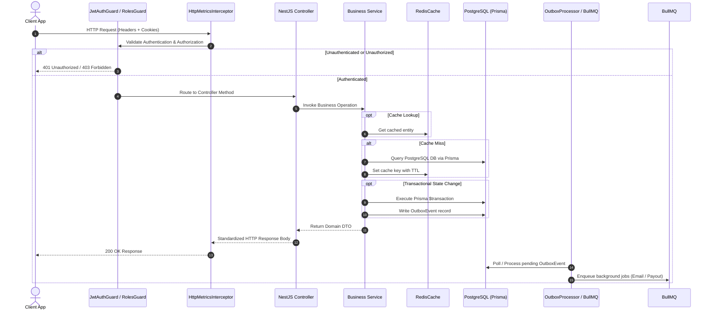

# Architecture Overview

## Purpose

VetsBridge is a comprehensive veterinary healthcare platform providing real-time telemedicine consultations, medical records management, marketplace e-commerce for pet supplies, and financial transaction processing. The system is designed to support high reliability, strict transaction idempotency, real-time audio/video telemetry, and role-separated workflows for pet owners, veterinarians, vendors, and platform administrators.

---

## Component Boundaries & NestJS Modules

The backend application is structured as a modular NestJS monolith organized into clear domain boundaries located under `src/modules` and `infra`:

```
src/
├── modules/
│   ├── identity/            # User profiles, auth, sessions, RBAC/PBAC
│   ├── telemedicine/        # Appointments, video rooms, chat, availability, notes
│   ├── payments/            # Paystack integration, double-entry ledger, payouts
│   ├── ecommerce/           # Vendor products, cart, checkout, shipping, orders
│   ├── animals/             # Pet profiles, health logs, vaccinations, ownership
│   ├── organizations/       # Shelter & farm organization multi-tenancy
│   ├── notifications/       # User notification persistence & dispatch
│   ├── admin/               # Administrative analytics, approvals, disputes
│   ├── media/               # File uploads, Cloudinary integration, signatures
│   └── search/              # Aggregated search indexing across entities
└── infra/
    ├── prisma/              # Prisma ORM database connection & lifecycle
    ├── redis/               # Redis connection manager & Redis cache engine
    ├── cache/               # Domain caching service & invalidation strategies
    ├── queues/              # BullMQ queue registrations & notification worker
    ├── outbox/              # Transactional outbox event publisher & worker
    ├── circuit-breaker/     # Resilience wrappers for external APIs (Resend, Paystack)
    ├── security/            # Encryption, token hashing, CSRF/XSS helpers
    └── throttler/           # Rate limiting guards & Redis storage backends
```

---

## Request Flow Lifecycle



---

## Key Design Decisions

1. **Modular Monolith**: Organized into strict domain modules within a single codebase to minimize deployment complexity while keeping boundary decoupling clean for future microservices splitting.
2. **Hybrid Authentication**: Uses stateless 15-minute JWT access tokens paired with stateful 7-day database-backed refresh tokens delivered exclusively over HTTP-Only cookies to protect against XSS and token reuse.
3. **Double-Entry Financial Ledger**: All monetary transfers, payments, and payouts enforce strict accounting balance invariants via immutable ledger entries (`LedgerEntry` model).
4. **Transactional Outbox Pattern**: Database mutations write domain events to an `OutboxEvent` table within the same ACID database transaction, preventing distributed state drift if external services (Resend, Paystack) fail during API handling.
5. **Circuit Breaker Integration**: Calls to external HTTP providers (Resend API) are wrapped in custom circuit breakers (`CircuitBreakerService`) to prevent cascading timeouts.

---

## Failure Scenarios & Resilience

| Subsystem Failure | Immediate Impact | System Resilience & Recovery Strategy |
| :--- | :--- | :--- |
| **Database Disruption** | API endpoints requiring database queries fail with `500 Server Error`. | Health checks at `/v1/health` report `DATABASE_DOWN`. Read operations cached in Redis continue serving until TTL expires. |
| **Redis Outage** | Cache misses, queue background workers pause, rate limiting falls back to local memory. | The `RedisService` catches errors silently and falls back gracefully to direct database queries. |
| **Paystack API Failure** | Payment verification or withdrawal payouts fail. | Webhooks log event payloads to `WebhookEventLog` with status `FAILED` and auto-retry via BullMQ exponential backoff. |
| **Resend API Failure** | Email notifications fail to deliver. | Circuit breaker opens to prevent connection exhaustion. Jobs remain queued in BullMQ `notifications` queue for automatic retry. |

---

## Extension Points

* **New Domain Modules**: Create a new module folder in `src/modules/<name>`, register the module in `src/app.module.ts`, define its controllers, services, and DTOs following existing module conventions.
* **Adding Outbox Handlers**: Extend `OutboxProcessor` switch-case block in `infra/outbox/outbox.processor.ts` to handle new `OutboxEvent` types.
* **Custom Metrics**: Inject `MonitoringService` and call `incrementCounter` or `observeHistogram` for domain-specific metrics.
