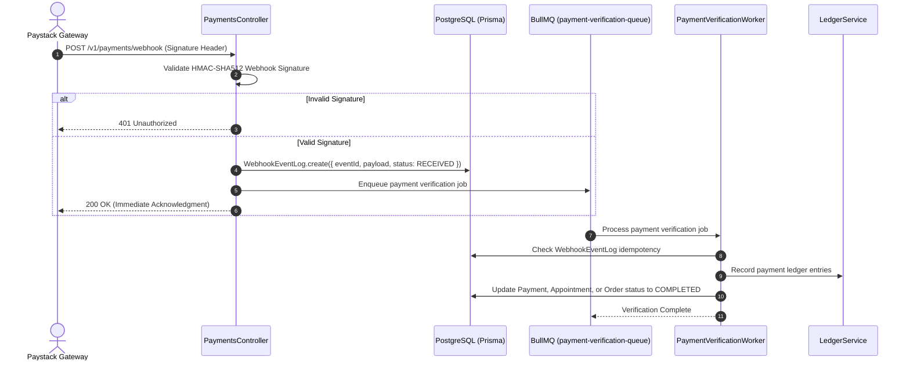
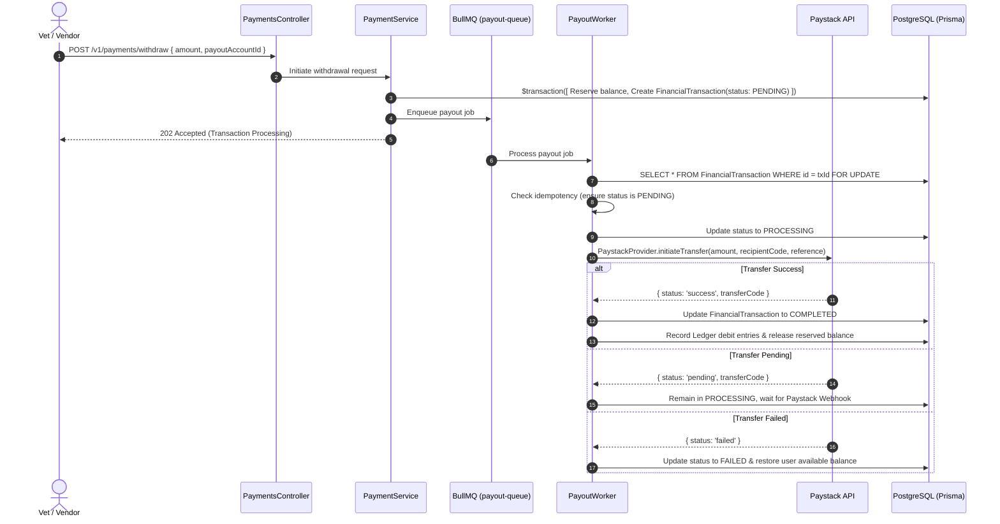

# Payment & Ledger System

## Purpose

The payment and ledger system processes monetary transactions, appointment escrow holds, vendor product checkouts, and withdrawal payouts. It enforces double-entry accounting integrity, idempotency, and secure webhook verification.

---

## Participating Modules & Files

* **Module**: `src/modules/payments/payments.module.ts`
* **Services**:
  - `src/modules/payments/services/payment.service.ts`
  - `src/modules/payments/services/ledger.service.ts`
* **Providers**:
  - `src/modules/payments/providers/paystack.provider.ts`
* **Workers**:
  - `src/modules/payments/workers/payment-verification.worker.ts`
  - `src/modules/payments/workers/payout.worker.ts`
* **Prisma Models**: `Payment`, `LedgerEntry`, `UserBalance`, `FinancialTransaction`, `WebhookEventLog`

---

## Double-Entry Ledger Architecture

All financial movements are recorded as paired DEBIT and CREDIT entries in the `LedgerEntry` table:

```
[ Customer Wallet / Card ] ──(DEBIT)──▶ [ Platform Escrow Account ]
                                                  │
                                          (Consultation Done)
                                                  │
                                                  ▼
[ Platform Escrow Account ] ──(DEBIT)──▶ [ Vet Balance Account ] ──(CREDIT)
```

---

## Webhook Processing & Payment Verification Flow



---

## Payout Withdrawal Lifecycle



---

## Design Decisions

1. **Immediate Webhook Response**: Webhooks acknowledge with `200 OK` within 50ms after saving the raw event payload to `WebhookEventLog`, moving verification to a background worker to avoid HTTP gateway timeouts.
2. **Database Locks on Payouts**: Uses `SELECT ... FOR UPDATE` SQL locks in `PayoutWorker` to eliminate race conditions when deducting user wallet balances.
