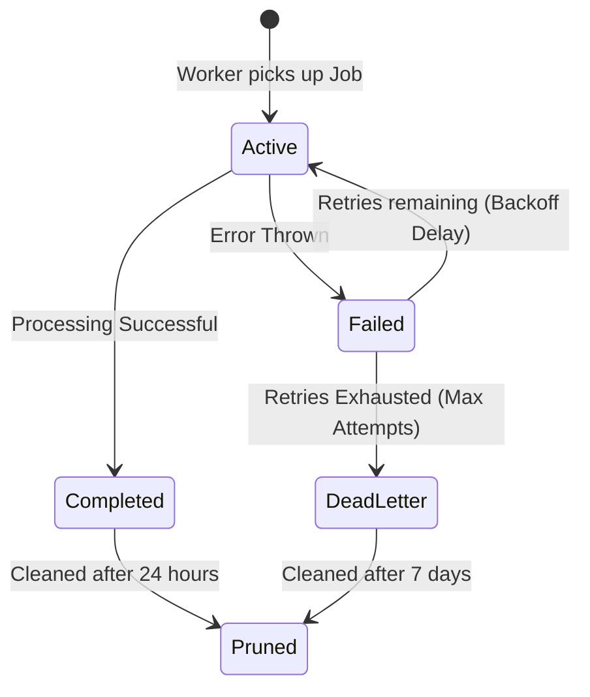

# Background Queues Subsystem

## Purpose

The background queue subsystem offloads long-running, asynchronous, and scheduled tasks (such as email delivery, withdrawal payouts, abandoned booking cleanup, and session pruning) from synchronous HTTP request threads to background BullMQ workers backed by Redis.

---

## Participating Modules & Workers

* **Queue Module**: `infra/queues/notifications-queue/notifications-queue.module.ts`
* **Workers**:
  - `infra/outbox/outbox.processor.ts` (`outbox-events` queue)
  - `infra/queues/notifications-queue/notifications-queue.worker.ts` (`notifications` queue)
  - `src/modules/telemedicine/consultations/services/consultation-lifecycle.worker.ts` (`consultation-lifecycle` queue)
  - `src/modules/telemedicine/consultations/services/unpaid-booking-cleanup.processor.ts` (`unpaid-booking-cleanup` queue)
  - `src/modules/payments/workers/payment-verification.worker.ts` (`payment-verification-queue` queue)
  - `src/modules/payments/workers/payout.worker.ts` (`payout-queue` queue)
  - `src/modules/identity/auth/services/session-cleanup.processor.ts` (`session-cleanup` queue)

---

## Active BullMQ Queues & Job Matrix

| Queue Name | Worker Class | Trigger Source | Job Actions & Description | Retry Policy |
| :--- | :--- | :--- | :--- | :--- |
| **`outbox-events`** | `OutboxProcessor` | `OutboxPoller` polling | Processes `USER_REGISTERED`, `CONSULTATION_SCHEDULED`, `PAYMENT_COMPLETED`, `ORDER_PLACED` | Exponential Backoff (3 attempts) |
| **`notifications`** | `NotificationsQueueWorker` | OutboxProcessor / Services | Dispatches `send-email` (Resend API) and `send-push` notifications | Exponential Backoff (5 attempts) |
| **`consultation-lifecycle`** | `ConsultationLifecycleWorker` | Appointment booking | `reminder` (24h/1h pre-call), `no-show`, `reconnect-timeout`, `escrow-release` | Fixed Backoff (3 attempts) |
| **`payment-verification-queue`** | `PaymentVerificationWorker` | Paystack Webhook | Verifies reference, completes payments, updates order/appointment state | Exponential Backoff (5 attempts) |
| **`payout-queue`** | `PayoutWorker` | Outbox / Withdrawal API | Initiates bank transfer payouts via Paystack API with DB locks | Manual / Strict Idempotent Retry |
| **`unpaid-booking-cleanup`** | `UnpaidBookingCleanupProcessor` | Native Cron (`*/15 * * * *`) | Cancels PENDING appointments > 30 mins unpaid | Scheduled Cron Retry |
| **`session-cleanup`** | `SessionCleanupProcessor` | Native Cron (`0 * * * *`) | Prunes expired DB sessions and used password reset tokens | Scheduled Cron Retry |

---

## Job Lifecycle Diagram

---

## Design Decisions

1. **BullMQ v5 Schedulers**: Scheduled maintenance jobs (session pruning, unpaid booking cleanup) use native BullMQ `upsertJobScheduler` for repeatable execution across app restarts.
2. **Idempotent Workers**: Job handlers verify idempotency keys or database state before performing side effects, preventing duplicate actions if a job is retried.
3. **Queue Metric Tracking**: BullMQ job state changes (active, completed, failed, delayed) increment Prometheus metrics in `src/monitoring/metrics/bull.metrics.ts`.
