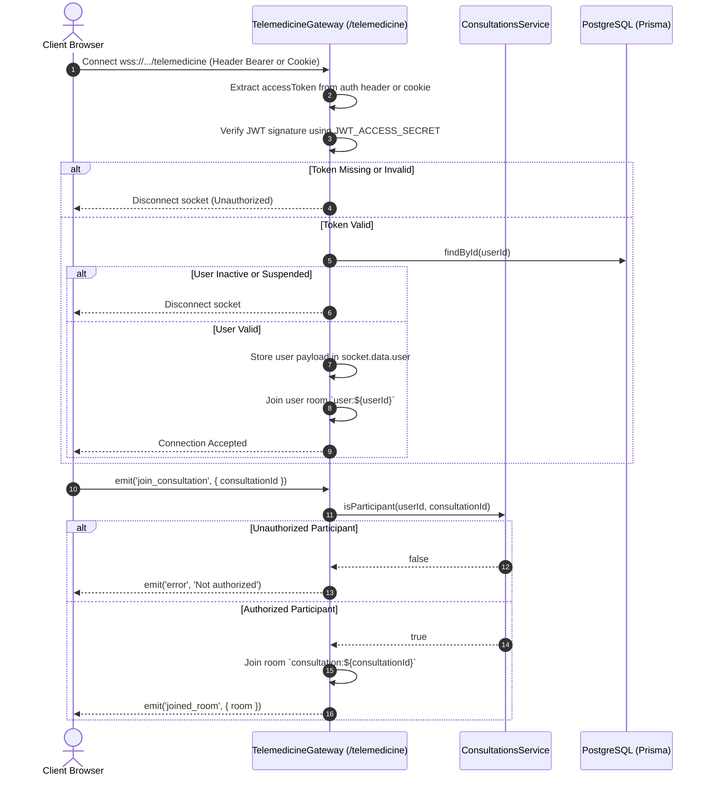

# WebSocket Infrastructure Subsystem

## Purpose

The WebSocket infrastructure provides real-time bi-directional telemetry and event streaming for live telemedicine consultations, live chat messaging, presence indicators, call status updates, and synchronized session termination.

---

## Participating Modules & Files

* **Gateway**: `src/modules/telemedicine/gateways/telemedicine.gateway.ts`
* **Namespace**: `/telemedicine`
* **Services**: `ConsultationsService`, `DirectMessagingService`, `UsersService`
* **Frontend Integration**: `components/consultation-chat.tsx`, `components/socket-notification-manager.tsx`

---

## WebSocket Connection & Authentication Flow

---

## Socket Event Catalog

| Event Name | Direction | Payload | Description |
| :--- | :--- | :--- | :--- |
| `join_consultation` | Client ➔ Gateway | `{ consultationId }` | Request to join room `consultation:${id}` |
| `send_consultation_message` | Client ➔ Gateway | `{ consultationId, content }` | Dispatch real-time chat message |
| `consultation_message` | Gateway ➔ Client | `ChatMessage DTO` | Broadcast new message to room participants |
| `consultation.completed` | Gateway ➔ Client | `{ consultationId }` | Signals veterinarian ended call; triggers auto-redirect |
| `consultation.cancelled` | Gateway ➔ Client | `{ consultationId }` | Signals session cancellation; resets global call widget |

---

## Failure Scenarios & Resilience

* **Network Disconnection**: Socket.io automatically falls back from WebSocket to Polling transports.
* **Reconnection Auto-Join**: Upon reconnecting, the client re-emits `join_consultation` to re-enter the room.
